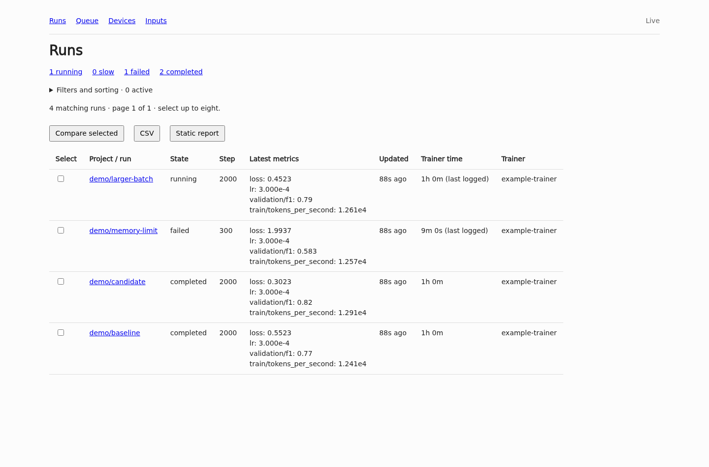
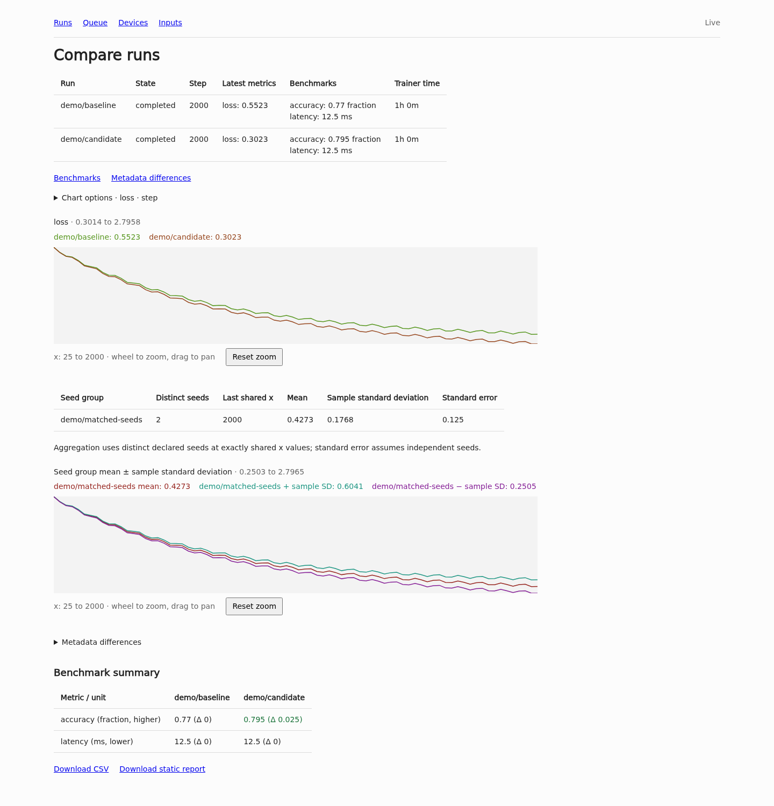
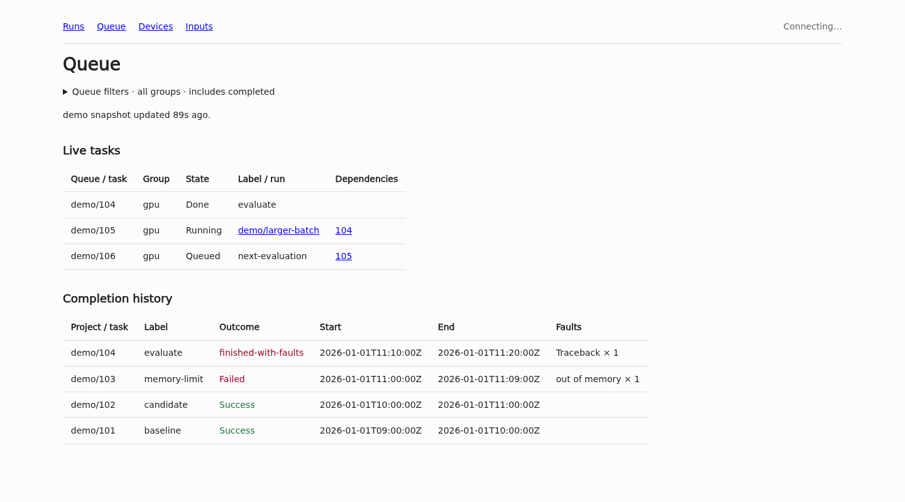

# runboard

A read-only dashboard for run metrics, queue state and device telemetry. Jobs
write files; runboard streams changes through a bundled NATS sidecar. No
tracking SDK is required.



## Run

```sh
nix build
./result/bin/runboard --root /path/to/project
```

Open <http://127.0.0.1:5000>. Each root must have a `reports/` directory. Name
roots explicitly to combine projects; run names can overlap:

```sh
./result/bin/runboard --root training=/path/to/training --root benchmarks=/path/to/benchmarks
```

Active runs appear first. Filters and chart options expand when needed; status,
latest values and benchmark highlights stay visible above the charts. Filter by
project, name, state, trainer, tag and metric range, with sorting and
pagination. Run IDs are `project/run`. Select up to eight to compare, export CSV
or download a standalone HTML report.

## Live updates

The normal command starts a private NATS server on `127.0.0.1:4223`, with
JetStream enabled. The Nix package includes the server. Use `--nats-port` to
choose another port or `--nats-url nats://host:4222` to use an external broker.
User/password and token authentication can be supplied in the external URL;
`tls://` enables TLS. Runboard does not stop an external broker.

State defaults to `$XDG_STATE_HOME/runboard/<project-scope>` or
`~/.local/state/runboard/<project-scope>`. Set `--state-dir` to choose a
location. One running instance owns each state directory. Managed-broker
credentials are kept there, including a connection URL in `nats.url`; keep this
directory private.

The file bridge checks for changes once a second and publishes sampled run,
device and queue events. Live Pueue status is cached for five seconds. Existing
files remain the source for full history, exports and page snapshots. Direct
publishing to NATS does not create file-backed runs.

Each project scope has its own `runboard.<scope>.>` subjects and
`RUNBOARD_<SCOPE>` stream. Retention is bounded to 24 hours, 512 MiB and one
million events, whichever limit is reached first. A durable consumer catches up
after restart; browser reconnects and slow-client gaps reconcile against a fresh
page snapshot.

Browsers receive server-sent events and reconcile changed snapshots without
reloading. Selections, edited filters, expanded details and scroll position are
preserved. Zoomed charts pause until Reset zoom. Connection status appears in
the navigation. Static HTML reports work without NATS or a network connection.

For NixOS, import `runboard.nixosModules.default` and configure:

```nix
services.runboard = {
  enable = true;
  roots = [ "training=/srv/training" ];
};
```

The unit manages the application and sidecar together, with persistent state
under `/var/lib/runboard`. Set `services.runboard.user` when accessing private
project files or that user's Pueue socket. `/healthz` reports live-input health.

## Inputs

| File                              | Contents                                                                                              |
| --------------------------------- | ----------------------------------------------------------------------------------------------------- |
| `reports/<run>_train.log`         | JSONL records with numeric `step` and arbitrary numeric metrics; plain log output may be interleaved. |
| `reports/<run>_meta.json`         | Optional parameters, seed, group, revision, dataset, tags and queue task ID.                          |
| `reports/<run>_summary.json`      | Optional final benchmark metrics, units and direction.                                                |
| `reports/<run>_progress.json`     | Optional heartbeat: `{"phase":"step","step":120,"pid":1234}`.                                         |
| `reports/<run>_TRAINED`           | `train exit 0` for success; other contents indicate failure/cancellation. Remove before restarting.   |
| `checkpoints/<run>/training.json` | Optional `trainer` and final `seconds`.                                                               |
| `reports/jobs.jsonl`              | Completed queue tasks from the callback.                                                              |
| `reports/queue.json`              | Optional Pueue `status --json` snapshot.                                                              |
| `reports/device_telemetry.jsonl`  | Timestamped numeric sensors, optionally labelled by `host` and `device`.                              |
| `artifacts/<run>/`                | Optional artifacts, available only with `--artifacts`.                                                |

A run log:

```jsonl
{"step":1,"seconds":12,"loss":1.8,"validation/f1":0.61}
{"step":2,"seconds":24,"loss":1.3,"validation/f1":0.69}
{"step":3,"seconds":36,"loss":0.9,"validation/f1":0.74}
```

Benchmark-only runs can have just a summary or metadata file, without a log.

Metadata:

```json
{"parameters":{"lr":0.0003},"seed":1,"group":"baseline","revision":"abc123","dataset":"validation-v2","tags":["pilot"],"task_id":42}
```

Benchmark summary:

```json
{"metrics":{"accuracy":{"value":0.85,"unit":"fraction","direction":"higher"},"latency":{"value":12.5,"unit":"ms","direction":"lower"}}}
```

Metric direction is `higher`, `lower` or `none`. Comparisons show deltas only
for matching units and directions. Existing paired-panel and JevBench reports
also appear in comparisons and exports.

Names use ASCII letters, digits, `.`, `_` and `-`, cannot start with `.` and are
limited to 200 bytes. Nested JSON keys are flattened with dots. Resuming at an
earlier step replaces the old branch from that step onward. Non-finite numbers
and incomplete writes are skipped; the Inputs page reports errors and read
limits.

Write JSON metadata and queue snapshots by atomic rename. Logs are tailed to 16
MiB and 100,000 records; charts display up to 32 metrics. Metadata is limited to
128 fields and 16 KiB of scalar data. Status uses markers and heartbeat age,
rather than checking local PIDs.

## Compare and share

Choose a metric, step/elapsed/wall-time axis, smoothing window and visible
range. Elapsed and wall-time axes require `seconds` and Unix-epoch `time` fields
in the log. Scroll to zoom a chart, drag to pan, or use Reset zoom. Colours stay
tied to run IDs.

Seed groups use matching `group`, parameters, revision and dataset, with
distinct `seed` values. Aggregation uses exactly shared x values and shows the
mean, sample standard deviation and standard error; the latter assumes
independent seeds.



CSV exports contain raw numeric records and final benchmark summaries. Static
reports contain selected metrics and summaries, without metadata tables, queue
data, telemetry or artifacts. Review the selected data before sharing. To create
a report from the command line:

```sh
./result/bin/runboard --root training=/path/to/project --export report.html --select training/baseline --select training/candidate
```

The output file must not already exist.

## Queue and devices

Read the existing callback history and live Pueue state:

```sh
./result/bin/runboard --root training=/path/to/project --jobs /path/to/shared/jobs.jsonl --pueue /etc/pueue/pueue.yml
```

`--pueue -` uses the default Pueue configuration. Status reads time out after
two seconds and are cached for five seconds. Alternatively, use
`--queue <snapshot>` or per-project `reports/queue.json`. Task IDs in metadata
and project-qualified labels link queue tasks to runs. Dependencies link to
their tasks. Runboard does not change the queue.



Completion records use `id`, `label`, `outcome`, `start`, `end` and a `faults`
object. `finished-with-faults` remains distinct from `Success`. Commands,
working paths and raw output are not displayed.

Telemetry records have Unix-epoch `time`, optional string `host`/`device`, and
numeric sensor fields such as `device/gpu_power_watts`. Each stream has its own
history and freshness; samples older than five minutes are marked stale.

## Artifacts and access

`--artifacts` enables bounded listings, text/image previews and downloads from
`artifacts/<run>/`. Files must be regular, at most 16 MiB, within the run's
artifact directory, and reached without symlinks. Artifact producers and
filesystem writers must be trusted.

The HTTP listener has no authentication or TLS. Keep it on loopback/private
networking or use an authenticated TLS proxy. `--root` is a data location, not a
filesystem sandbox. The server never writes producer files.

## Development

```sh
nix develop
cargo test --all-targets
cargo clippy --all-targets -- -D warnings
cargo fmt --all
nixfmt flake.nix nix/module.nix
taplo format Cargo.toml rustfmt.toml
mdformat --wrap 80 --number README.md
nix flake check
```

The flake uses flake-parts, devshell, Crane and rust-overlay. Targets are x86-64
Linux, ARM64 Linux and ARM64 macOS. The shell matches the Conform formatters.
Generated files are left to their generators.

GitHub CI builds and checks all three platforms on pushes to `main` and pull
requests. Linux CI also checks repository formatting, dependency advisories and
Git history for secrets.

Set `services.runboard.deploy.enable = true` for automatic NixOS deployments. A
dedicated user checks the public GitHub repository every two minutes and builds
the exact revision only after its `CI` push workflow succeeds. Activation
restarts runboard and checks `/healthz`; a failed health check restores the
previous release. Builds need no GitHub token or inbound deployment port. The
first release starts after CI passes. Keep deployment disabled for private
repositories; the pull service uses public HTTPS access.

Generate synthetic input in a fresh directory with
`cargo run --example demo -- target/demo`, then serve it with
`cargo run -- --root demo=target/demo --artifacts`.

[MIT](LICENSE).
